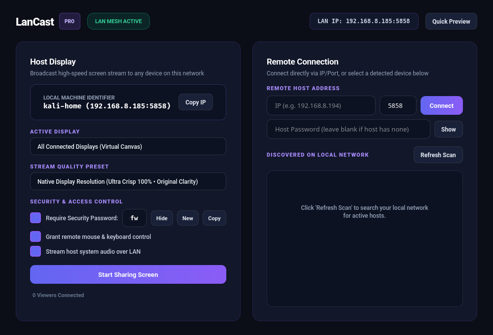

# LanCast Pro

**Ultra-fast, zero-cloud peer-to-peer screen sharing and remote desktop engineered exclusively for local area networks (Wi-Fi and Ethernet).**

Delivers native 60 FPS streaming with ultra-low latency (~1.1 ms round-trip time) over pure TCP sockets, full remote keyboard and mouse control, multi-monitor switching, and end-to-end local security.

---

## Screenshots

<div align="center">

### Main Dashboard & Local Network Discovery


### Floating Viewer HUD & Multi-Display Controls


### Active High-Resolution Remote Desktop Session


</div>

---

## Download & Installation

Get precompiled releases for your operating system directly from [GitHub Releases](https://github.com/USER/REPO/releases/latest).

> Replace `USER/REPO` with your repository path when publishing.

### Direct Download Endpoints

| Platform | Package Format | Direct Download URL | Installation / Run Command |
| :--- | :--- | :--- | :--- |
| **Linux (Universal)** | Standalone AppImage | [`LanCast-1.0.0.AppImage`](https://github.com/USER/REPO/releases/latest/download/LanCast-1.0.0.AppImage) | `chmod +x LanCast-1.0.0.AppImage && ./LanCast-1.0.0.AppImage` |
| **Arch Linux / Manjaro** | Pacman Package | [`lancast-1.0.0-1-x86_64.pkg.tar.zst`](https://github.com/USER/REPO/releases/latest/download/lancast-1.0.0-1-x86_64.pkg.tar.zst) | `sudo pacman -U lancast-1.0.0-1-x86_64.pkg.tar.zst` |
| **Debian / Ubuntu / Kali** | Debian Package | [`lancast_1.0.0_amd64.deb`](https://github.com/USER/REPO/releases/latest/download/lancast_1.0.0_amd64.deb) | `sudo dpkg -i lancast_1.0.0_amd64.deb` |
| **Linux Portable** | Standalone Tarball | [`LanCast-1.0.0-linux-x86_64.tar.gz`](https://github.com/USER/REPO/releases/latest/download/LanCast-1.0.0-linux-x86_64.tar.gz) | `tar -xzf LanCast-1.0.0-linux-x86_64.tar.gz && ./usr/bin/lancast` |
| **Windows 10 / 11** | Portable Executable | [`LanCast-Portable.exe`](https://github.com/USER/REPO/releases/latest/download/LanCast-Portable.exe) | Double-click to launch (No installation required) |
| **macOS (Apple / Intel)** | Disk Image | [`LanCast-1.0.0.dmg`](https://github.com/USER/REPO/releases/latest/download/LanCast-1.0.0.dmg) | Open DMG and drag LanCast to Applications |
| **Android (Phone / Tablet)**| Native Android APK | [`LanCast-1.0.0.apk`](https://github.com/USER/REPO/releases/latest/download/LanCast-1.0.0.apk) | Download and install APK on your Android device |

---

## Operating System Setup Guides

### 🐧 Linux (AppImage & Native Packages)
* **AppImage**: Works out-of-the-box across Ubuntu, Debian, Fedora, Arch, openSUSE, and CentOS:
  ```bash
  wget https://github.com/USER/REPO/releases/latest/download/LanCast-1.0.0.AppImage
  chmod +x LanCast-1.0.0.AppImage
  ./LanCast-1.0.0.AppImage
  ```
* **Arch Linux / Manjaro**:
  ```bash
  wget https://github.com/USER/REPO/releases/latest/download/lancast-1.0.0-1-x86_64.pkg.tar.zst
  sudo pacman -U lancast-1.0.0-1-x86_64.pkg.tar.zst
  ```
* **Debian / Ubuntu / Kali**:
  ```bash
  wget https://github.com/USER/REPO/releases/latest/download/lancast_1.0.0_amd64.deb
  sudo dpkg -i lancast_1.0.0_amd64.deb
  ```

### 🪟 Windows (10 & 11)
1. Download `LanCast-Portable.exe`.
2. Double-click the file to open the dashboard immediately.
3. If prompted by Windows Defender SmartScreen, select **More info** -> **Run anyway**.

### 🍎 macOS
1. Download `LanCast-1.0.0.dmg`.
2. Double-click to mount and drag `LanCast.app` into your **Applications** folder.
3. Grant **Screen Recording** and **Accessibility** permissions in macOS *System Settings > Privacy & Security* when prompted to enable capture and input simulation.

### 📱 Android
1. Download `LanCast-1.0.0.apk` to your phone or tablet.
2. Tap the downloaded file to install (allow "Install unknown apps" if prompted).
3. Open the app to view and control your desktop screens using touch gestures and the virtual shortcut toolbar.
4. *Alternative*: Connect from any mobile device without installing anything by simply scanning the desktop dashboard QR code with your camera.

---

## Key Features

### 🚀 Ultra-Low Latency Performance
* **1.1 ms Network Latency**: Uses dedicated monotonic ping-pong RTT tracking and 512 KB socket buffers to prevent buffer bloat and queue congestion.
* **Native 60 FPS Display**: Hardware-accelerated Qt6 paint pipeline ensures smooth, high-frame-rate desktop rendering at full native display resolution.
* **Zero Cloud Dependence**: Operates strictly within your local Wi-Fi or wired network. No remote relays, no external servers, and zero internet bandwidth consumed.

### 🖥️ Multi-Monitor Workflow
* **Flexible Display Views**: Stream monitor 1, monitor 2, or a unified multi-screen canvas covering all attached displays.
* **Live In-Session Switching**: Switch between screens dynamically via the dropdown in the floating viewer toolbar without disconnecting.

### 🖱️ Complete Remote Control
* **Mouse Simulation**: High-precision pointer tracking, primary/secondary/middle clicks, and mouse wheel scrolling.
* **Typing & Keyboard Shortcuts**: Full remote keystroke handling including function keys, modifier combos, and direct text input.
* **Bidirectional Clipboard**: Automatically synchronizes clipboard text between host and viewer in real time.

### 🛡️ Local Security & Access Management
* **Interactive Authorization**: When a remote peer connects, the host receives an approval dialog allowing them to accept or decline the session.
* **Fine-Grained Permissions**: Enable or disable remote mouse/keyboard control and audio streaming on a per-session basis.
* **Dynamic Security Passwords**: Generate random one-time session passwords or set custom passwords with password visibility toggles.

### 🔍 Seamless LAN Discovery
* **Auto-Discovery Beacon**: Automatically detects other active LanCast machines on your subnet using UDP broadcast and mDNS.
* **On-Demand Refresh**: Scan your subnet whenever needed with the dedicated refresh button, keeping network traffic minimal.
* **9-Digit Device Address**: Connect with a clean 9-digit address (e.g. `192 168 008 194`) or direct IP.

### 📱 Mobile Virtual Keyboard & Modifier Bar
* **Special Keys Toolbar**: Includes dedicated buttons for `Ctrl`, `Alt`, `Shift`, `Esc`, `Tab`, `Win`, and navigation arrows directly on the mobile interface.
* **Virtual Trackpad**: Control the desktop cursor smoothly with touch taps, double taps, and drag gestures.

---

## Building from Source (Developers Only)

If you prefer building packages locally instead of downloading from Releases:

```bash
# Clone the repository
git clone https://github.com/USER/REPO.git
cd REPO

# Install Python requirements
pip install -r requirements.txt

# Run the native application
python3 main.py

# Build all distribution packages (Linux AppImage, Debian .deb, Arch pkg, Android APK)
./scripts/build-all.sh all
```
