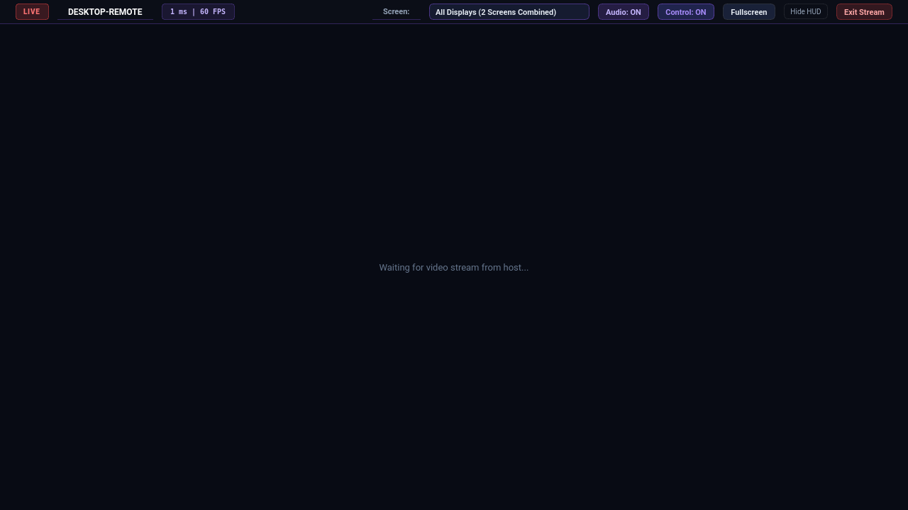
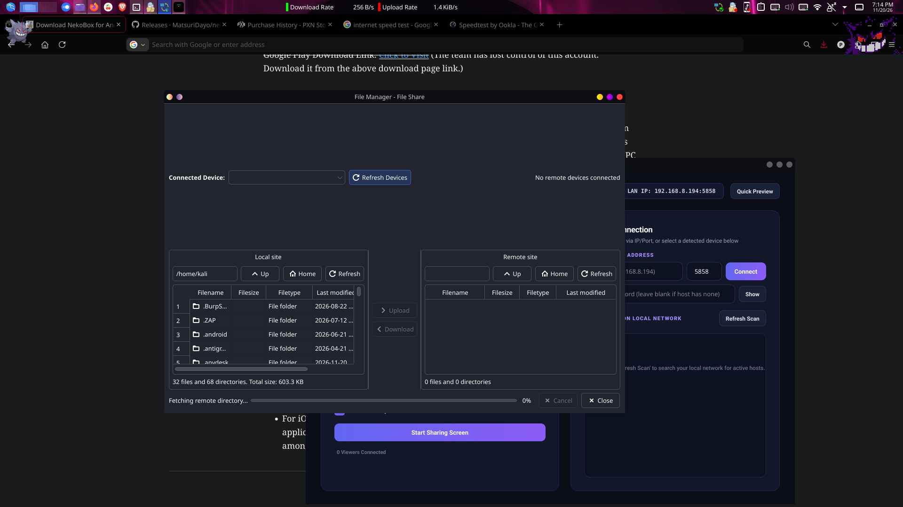

# 🐕 DogRemoteLocal

**Ultra-fast, zero-cloud peer-to-peer screen sharing and remote desktop engineered exclusively for local area networks (Wi-Fi and Ethernet).**

Delivers native 60 FPS streaming with ultra-low latency (~1.1 ms round-trip time) over pure TCP sockets, full remote keyboard and mouse control, multi-monitor switching, and end-to-end local security.

---

## Screenshots

<div align="center">

### Main Dashboard & Local Network Discovery


### Floating Viewer HUD & Multi-Display Controls


### Active High-Resolution Remote Desktop Session


</div>

---

## Download & Run

Get the latest universal standalone AppImage directly from [GitHub Releases](https://github.com/Prekarshamaxx123/DogRemoteLocal/releases/latest).

### Direct Download Endpoint

| Platform | Package Format | Direct Download URL | Run Command |
| :--- | :--- | :--- | :--- |
| **Linux (Universal)** | Standalone AppImage | [`DogRemote-1.0.0.AppImage`](https://github.com/Prekarshamaxx123/DogRemoteLocal/releases/latest/download/DogRemote-1.0.0.AppImage) | `chmod +x DogRemote-1.0.0.AppImage && ./DogRemote-1.0.0.AppImage` |

---

## Quick Start Guide

Works out-of-the-box across Ubuntu, Debian, Fedora, Arch, openSUSE, and Kali Linux without installation:
```bash
wget https://github.com/Prekarshamaxx123/DogRemoteLocal/releases/latest/download/DogRemote-1.0.0.AppImage
chmod +x DogRemote-1.0.0.AppImage
./DogRemote-1.0.0.AppImage
```

---

## Key Features

### 🚀 Ultra-Low Latency Performance
* **1.1 ms Network Latency**: Uses dedicated monotonic ping-pong RTT tracking and 512 KB socket buffers to prevent buffer bloat and queue congestion.
* **Native 60 FPS Display**: Hardware-accelerated Qt6 paint pipeline ensures smooth, high-frame-rate desktop rendering at full native display resolution.
* **Zero Cloud Dependence**: Operates strictly within your local Wi-Fi or wired network. No remote relays, no external servers, and zero internet bandwidth consumed.

### 🖥️ Multi-Monitor Workflow
* **Flexible Display Views**: Stream monitor 1, monitor 2, or a unified multi-screen canvas covering all attached displays.
* **Live In-Session Switching**: Switch between screens dynamically via the dropdown in the floating viewer toolbar without disconnecting.

### 🖱️ Complete Remote Control
* **Mouse Simulation**: High-precision pointer tracking, primary/secondary/middle clicks, and mouse wheel scrolling.
* **Typing & Keyboard Shortcuts**: Full remote keystroke handling including function keys, modifier combos, and direct text input.
* **Bidirectional Clipboard**: Automatically synchronizes clipboard text between host and viewer in real time.

### 🛡️ Local Security & Access Management
* **Interactive Authorization**: When a remote peer connects, the host receives an approval dialog allowing them to accept or decline the session.
* **Fine-Grained Permissions**: Enable or disable remote mouse/keyboard control and audio streaming on a per-session basis.
* **Dynamic Security Passwords**: Generate random one-time session passwords or set custom passwords with password visibility toggles.

### 🔍 Seamless LAN Discovery
* **Auto-Discovery Beacon**: Automatically detects other active DogRemote machines on your subnet using UDP broadcast and mDNS.
* **On-Demand Refresh**: Scan your subnet whenever needed with the dedicated refresh button, keeping network traffic minimal.
* **9-Digit Device Address**: Connect with a clean 9-digit address (e.g. `192 168 008 194`) or direct IP.

---

## Building from Source (Developers Only)

If you prefer building packages locally instead of downloading from Releases:

```bash
# Clone the repository
git clone https://github.com/Prekarshamaxx123/DogRemoteLocal.git
cd DogRemoteLocal

# Install Python requirements
pip install -r requirements.txt

# Run the native application
python3 main.py

# Build the standalone Universal Linux AppImage
./scripts/build-all.sh appimage
```
